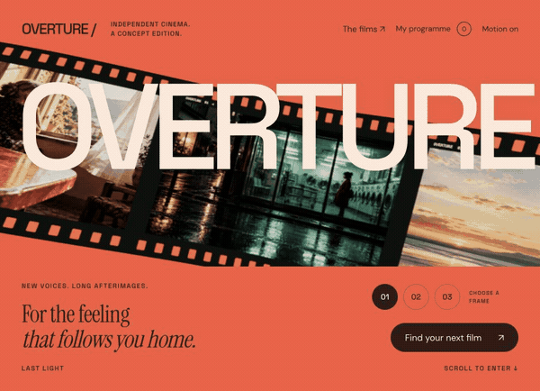

# OVERTURE Film Festival

Film & culture · Independent concept demo

A curved filmstrip unfurls into a cinema screen, leading into a programme you can explore and save.

**[Visit the live site ↗](https://northlight7.github.io/cinematic-overture/)** · [Project notes & screenshots](https://github.com/northlight7/web-design-portfolio/tree/main/projects/overture) · [Full portfolio](https://northlight7.github.io/web-design-portfolio/)



## What to try

Choose a projected frame, filter the programme, read a film note and save a selection.

## Design focus

A curved celluloid strip straightens and expands into a full-screen projection, connecting the entrance to the film programme.

Select the projected frame, filter films, open their notes and save or remove programme selections.

## Run locally

This is a buildless static site. Serve this repository with a static HTTP server, for example:

```sh
python3 -m http.server 8080
```

Then open http://localhost:8080 in your browser. Fonts, dependencies and visual assets are hosted locally with the site.

## About this work

Created through AI-assisted design and development, iterative art direction and browser testing. This is fictional concept work, with no client affiliation or commercial results claimed. The animation condenses an actual browser scroll walkthrough into a short silent loop.
